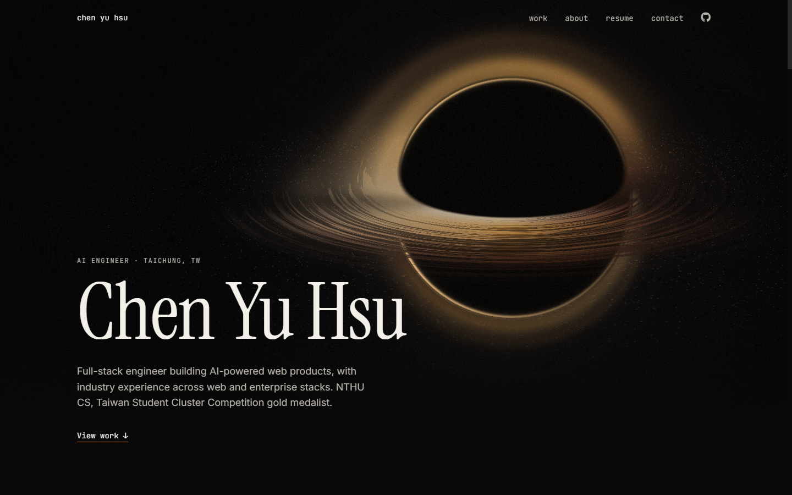

<div align="center">

<h1>Chen Yu Hsu — Portfolio</h1>

<p>Personal Portfolio & Interactive Work Collection · Vue 3 + Vite 5</p>

<br/>

[](https://chenyuhsu413.github.io/ChenYuPersonalPage/)
[](https://github.com/ChenYuHsu413/ChenYuPersonalPage/actions)
[](https://github.com/ChenYuHsu413/ChenYuPersonalPage/commits/main)

<br/><br/>

[](https://skillicons.dev)

<br/><br/>

[](https://chenyuhsu413.github.io/ChenYuPersonalPage/)

</div>

---

## ✨ Features

- 🕳 **Black Hole Hero** — Full-viewport WebGL black hole (Schwarzschild raymarched accretion disk, photon ring, lensed back-disk arc, particle swarm, "formation" intro). Pauses off screen, renders a single still frame under `prefers-reduced-motion`, uses lighter settings on phones, and falls back to a static image without WebGL
- 🗂 **Numbered Work List** — Editorial list with All / Professional / AI & ML / Web & Data / Game Tools / Archive tabs; All shows `featured` projects first, then the rest by category order
- 🖼 **Hover Previews** — On wide desktop screens the hovered row's screenshot appears in a dedicated column; tablets and phones show it inline under each row
- ⌨️ **Keyboard Friendly** — Every work row is focusable, Enter opens the project modal, focus mirrors hover
- 📋 **Project Detail Modal** — Description, tech tags, metadata, live demo / source links, and an unofficial-project notice for Game Tools
- 🌑 **Dark Editorial Design** — Single dark theme, one warm accent color, Instrument Serif / Inter / JetBrains Mono with Noto Sans TC for Chinese
- 🎞 **Light Motion** — Sections fade in once via a shared IntersectionObserver helper; no animation library
- 📧 **EmailJS Contact Form** — Serverless delivery with loading / success / error states and auto-reply to sender
- 🌐 **Open Graph Preview** — OG + Twitter Card meta tags for rich link previews
- 📊 **GitHub API Stats** — Live public repo count fetched from the GitHub API

---

## 🛠 Tech Stack

| Layer | Technology |
|---|---|
| **Framework** |  Composition API · `<script setup>` SFC |
| **Build Tool** |  HMR · GitHub Pages base path |
| **Graphics** |  Zero-dependency black hole module (`src/blackhole/`) |
| **Email** |  `@emailjs/browser` · no backend required |
| **Styling** |  Design tokens in `style.css` (color, type, spacing) · no CSS framework |
| **Fonts** | Google Fonts: Instrument Serif · Inter · JetBrains Mono · Noto Sans TC |
| **Icons** |  CDN |
| **Deploy** |  →  |

---

## 🧊 Redesign Notes

The site moved from the earlier glassmorphism look to a dark, editorial-minimal design (rounds 1–2, 2026-11):

- Design tokens (`--bg`, `--text`, `--text-2`, `--text-3`, `--line`, `--accent`, type and spacing scales) live at the top of `src/style.css`. Dark theme only; the light theme, glass effects, animated background and GSAP were removed.
- `src/blackhole/` is a zero-dependency WebGL module adapted from the author's own visual-lab experiment: `initBlackHole(el, options)` returns `{ pause, resume, destroy, setOpacity }`. The hero passes its own options (center, radius, exposure, and lighter settings on phones).
- `vite-app/lab/blackhole.html` is a dev-only test page with sliders for every option (`?stats=1` shows FPS). Open it at `/ChenYuPersonalPage/lab/blackhole.html` under `npm run dev`; it is not part of the build.
- `public/sources/blackhole-still.webp` is the no-WebGL fallback, rendered from the module itself.
- Before/after screenshots: `docs/redesign/round1/`, `docs/redesign/round2/`.
- The latest implementation was verified with `npm run build` on 2026-11-09.
- 2026-11-09 content update: re-split work categories into five (Professional / AI & ML / Web & Data / Game Tools / Archive), added 3 projects (ECHOAi website, LoL Worlds 2026, Deskrawl Monitor), and updated the Resume timeline.
- Pending: `game-deskrawl-monitor` temporarily uses its GitHub OpenGraph image (`sources/game-deskrawl-monitor-og.png`); replace it with a Discord notification screenshot later.

Detailed notes:

- [log.md](./log.md) — 整理 Claude 討論與改版過程
- [docs/glassmorphism-redesign-workfile.md](./docs/glassmorphism-redesign-workfile.md) — 前一版（毛玻璃）改版的工作檔，僅供參考
- [docs/dev-log.md](./docs/dev-log.md) — 專案開發紀錄

---

## 📁 File Structure

```text
ChenYuPersonalPage/
|-- README.md
|-- log.md                     # Redesign discussion summary
|-- .gitignore
|-- .github/
|   └── workflows/
|       └── deploy.yml         # GitHub Actions: build vite-app → GitHub Pages
|-- vite-app/                  # Vite 5 + Vue 3 SFC
|   |-- index.html
|   |-- vite.config.js
|   |-- package.json
|   |-- lab/
|   |   └── blackhole.html     # Dev-only black hole test page (not built)
|   |-- public/
|   |   └── sources/           # Static assets (project screenshots, black hole still)
|   └── src/
|       |-- App.vue            # Shared state, project filtering, EmailJS
|       |-- main.js
|       |-- style.css          # Design tokens + all styles
|       |-- blackhole/         # blackhole.js (module) · shaders.js (GLSL)
|       |-- utils/reveal.js    # IntersectionObserver fade-in helper
|       |-- data/projects.js   # PROJECTS static data module
|       └── components/        # 9 SFCs
|                              # AppHeader · HeroSection · WorkSection
|                              # AboutSection · ResumeSection · HonorsSection
|                              # ContactSection · ProjectModal · AppFooter
└── docs/
    |-- AGENT.md
    |-- dev-log.md
    |-- glassmorphism-redesign-workfile.md
    |-- interview-qa.md
    |-- redesign/              # Round 1–2 screenshots
    └── 工作報告.md
```

---

## ➕ How to Add New Projects

Open `vite-app/src/data/projects.js` and add a new object to the `PROJECTS` array:

```javascript
{
    id: 'hw-new',
    title: 'Your Project Title',
    category: 'aiml',              // 'professional', 'aiml' (AI & ML), 'web' (Web & Data), 'game' (Game Tools), or 'archive'
    highlight: 'One-line outcome badge shown on the card',
    shortDescription: 'Short card description.',
    longDescription: 'Full description shown in the modal.',
    tags: ['Python', 'Streamlit'],
    demoUrl: 'https://your-demo-url.com',
    githubUrl: 'https://github.com/ChenYuHsu413/your-repo',
    previewImage: 'https://raw.githubusercontent.com/.../screenshot.png',
    colorGradient: 'linear-gradient(135deg, #3b82f6 0%, #8b5cf6 100%)',
    date: '2026'
}
```

Then push to `main` — GitHub Actions will automatically rebuild and redeploy.

---

## 🚀 How to Run Locally

```bash
cd vite-app
npm install
npm run dev
# → http://localhost:5173/ChenYuPersonalPage/
```

---

<div align="center">

Made with ❤️ by [Chen Yu Hsu](https://github.com/ChenYuHsu413)

</div>
